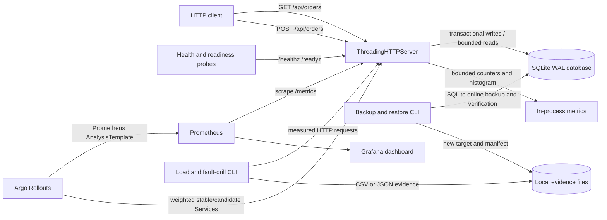

# Architecture

The service uses only Python's standard library. Each HTTP worker opens and
closes short-lived SQLite connections. Schema setup is transactional; order
creation is committed as one SQLite transaction. Metrics are held in process
memory and aggregated into a finite label set.

The same application image runs in Docker Compose and the Kubernetes Rollout.
Kubernetes uses disjoint stable and candidate Service selectors managed by Argo
Rollouts and one ordinary Service for weighted client traffic. Pod metric
scrape discovery attaches `track=stable` or `track=candidate`; the Python
process itself emits no deployment-specific or user-derived labels.

SQLite is shared on one ReadWriteOnce volume in the Kubernetes example. That
keeps the deployment reproducible for a one-node lab, but it does not provide
multi-node database availability, replication, or storage-level failover.
